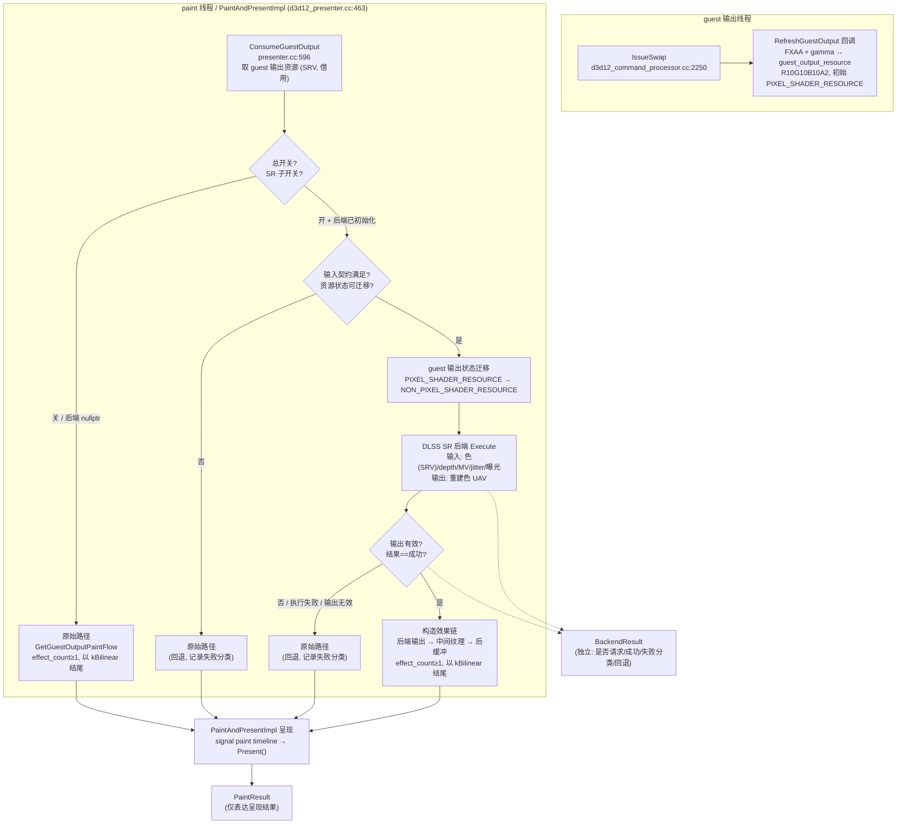

# Milestone 1 — RTX 4090 优先的 NVIDIA 图形增强架构设计

> 状态：架构设计稿（DESIGN），**用户已正式批准**（2026-10-20，决策 1–7，见 §L3）。
> 本阶段**仅做只读分析、证据核查、架构设计、文档编写**。未实现任何代码、未构建、未加载 DLL、未执行 GPU 操作、未创建 Mock。
> **当前进度**：Milestone 1 架构已批准；**Milestone 2 已完成并正式验收**（最小后端接口骨架、默认关闭配置、独立结果契约、原始路径回退构造器、路径选择函数与主机侧测试，独立交付审查结论 `PASS WITH FINDINGS`）；**Milestone 3-A / 3-B / 3-C 已完成**（DLSS SR 真实后端与 Presenter 接线、UI 开关 Phase 1 主开关 + SR 子复选框与 Phase 2 质量滑块、RTX 4090 实机运行时验证 `RUNTIME_VERIFIED_ON_RTX4090`）；**Milestone 3.1（DLSS SR render preset 切换）已完成**（调查 + 设计 + 实施，release 构建通过、主机侧测试全绿 18 用例 / 53 断言，真实后端逻辑 `UNVERIFIED`）；**DLAA（1:1 自动切换）已完成本地实现**（SR 启用且输入=输出分辨率时按 DLAA 处理，UI 档位不覆盖，主机侧测试 45 用例 / 1238 断言全绿，真实 GPU DLAA 执行 `UNVERIFIED`）。详见 `docs/dlss-integration/` 下对应里程碑文档。
> 证据标签约定：`STATIC_VERIFIED`（当前源码已核实）｜`SDK-DOC-SUPPORTED`（SDK 文档/头文件支持）｜`DESIGN PROPOSAL`（本设计建议）｜`UNVERIFIED`（未验证）｜`RUNTIME_VERIFIED_ON_RTX4090`（仅在真实 RTX 4090 证据存在时使用——Milestone 3-C 已产出首批此类证据）。

---

## A. 总结与设计状态

### A1. 设计结论速览

- **首要目标硬件**：NVIDIA GeForce RTX 4090（Ada，`AD102`）。`STATIC_VERIFIED`（硬件型号由测试机约定给定）。
- **首个可运行版本**：DLSS SR（`SuperSampling`，特征枚举 =1）作为唯一主线后端，采用**方案 A**（直接复用现有 guest 输出纹理 + 一次资源状态迁移）。`SDK-DOC-SUPPORTED` + `DESIGN PROPOSAL`。
- **默认关闭语义**：通过**结构设计**保证（非仅文档约定）。总开关关闭 → 不加载 DLL、不初始化后端、不创建后端资源、不执行额外 GPU 步骤、不改变现有资源同步与 Presenter 生命周期。`DESIGN PROPOSAL`。
- **唯一回退路径**：原始效果链 `effect_count ≥ 1` 且最终效果 `kBilinear`。**严禁**使用 `effect_count = 0` 作为回退（会丢失 guest 输出并清屏为黑）。`STATIC_VERIFIED`。
- **后端结果契约**：新增独立枚举，与 `PaintResult` 正交。后端成功 ≠ 最终呈现成功。`DESIGN PROPOSAL`。
- **NVOF**：独立模块设计，**不**假定它是唯一运动矢量来源。`DESIGN PROPOSAL`。
- **帧生成 / Ray Reconstruction / 实验性神经渲染**：仅定义扩展边界与隔离策略，**不**成为首个 SR 版本的强制依赖。`DESIGN PROPOSAL`。

### A2. 本阶段证据等级总览

| 标签 | 本阶段使用情况 |
|---|---|
| `STATIC_VERIFIED` | 全部源码结论（Presenter 流程、guest 输出资源、状态、UAV、效果链门控、邮箱/Fence/paint-refs 契约、回退路径）。已对当前源码逐条复核。 |
| `SDK-DOC-SUPPORTED` | SDK 头文件与官方文档的输入契约、生命周期、格式、颜色空间、错误码、许可条款。已核对 310.9.1 头文件与 310.6.0/310.7.0/v08 文档。 |
| `DESIGN PROPOSAL` | 模块边界、配置结构、后端结果契约、回退策略、架构方案选择。 |
| `UNVERIFIED` | 一切真实 GPU 执行、NVOF 执行、DLSS `Evaluate`、输出画质、延迟、帧时间、显存占用、状态迁移在真实 GPU 上的正确性。 |
| `RUNTIME_VERIFIED_ON_RTX4090` | **本阶段无任何项**。真实 RTX 4090 测试机未接入（当前为 Hyper-V，无 NVIDIA 驱动/GPU）。 |

### A3. 设计状态声明

- 本阶段**未**执行构建，**未**加载 NVIDIA DLL，**未**执行 DLSS `Evaluate` 或 NVOF 执行，**未**做性能测试。
- 本阶段**未**将 SDK 文件存在等同于运行时可用。
- 本阶段**未**将静态审计等同于编译通过或运行时验证。
- 本阶段**未**将运动矢量缺失推导为所有 DLSS SR 模式绝对不可用。
- 本阶段**未**将“DLSS 5”项目目标名称理解为当前 SDK 已提供全部对应功能。

---

## B. 当前源码架构及证据

> 本节所有行号基于当前 HEAD `8a7afe3c`（`dev/dlss5-integration` 分支，干净工作树）复核。旧审计报告行号仅作检索起点，已按当前源码重新确认。

### B1. guest output 进入 Presenter 的完整链路

GPU 线程 → Presenter 的入口是 `D3D12CommandProcessor::IssueSwap`：

- `IssueSwap`（`src/xenia/gpu/d3d12/d3d12_command_processor.cc:2250`）在客机 swap 时被调用。`STATIC_VERIFIED`
- 调用 `texture_cache_->RequestSwapTexture(swap_texture_srv_desc, frontbuffer_format)`（:2270）获取客机最终 resolved 输出纹理 `swap_texture_resource`（客机原生分辨率）。`STATIC_VERIFIED`
- 调用 `presenter->RefreshGuestOutput(w, h, aspect, callback)`（:2279）。回调内对 guest 输出资源执行 **FXAA + gamma ramp** compute。`STATIC_VERIFIED`
- 回调内：`context.resource_uav_capable()` 取得 guest 输出资源（初始状态 `kGuestOutputInternalState`），`PushTransitionBarrier(..., D3D12_RESOURCE_STATE_UNORDERED_ACCESS)` 迁移为 UAV，创建 UAV 写入 gamma 结果，再迁回 `kGuestOutputInternalState`。`STATIC_VERIFIED`（`d3d12_command_processor.cc:2425-2450` 附近）

**契约（`d3d12_presenter.h:77-79`）**：guest 输出回调初始状态为 `kGuestOutputInternalState`，回调**必须**在使用后迁回该状态。`STATIC_VERIFIED`

### B2. guest 输出资源定义（`D3D12GuestOutputRefreshContext`）

| 项 | 值 | 位置 | 标签 |
|---|---|---|---|
| `kGuestOutputFormat` | `R10G10B10A2_UNORM` | `d3d12_presenter.h:58-59` | `STATIC_VERIFIED` |
| `kGuestOutputInternalState` | `D3D12_RESOURCE_STATE_PIXEL_SHADER_RESOURCE` | `d3d12_presenter.h:60-61` | `STATIC_VERIFIED` |
| `kGuestOutputIntermediateFormat` | `R10G10B10A2_UNORM` | `d3d12_presenter.h:63-64` | `STATIC_VERIFIED` |
| `kSwapChainFormat` | `B8G8R8A8_UNORM` | `d3d12_presenter.h:67` | `STATIC_VERIFIED` |
| UAV 能力 | 创建时 `Flags = ALLOW_UNORDERED_ACCESS`，`Layout = UNKNOWN` | `d3d12_presenter.cc:420-427` | `STATIC_VERIFIED` |
| 尺寸 | `frontbuffer_width × frontbuffer_height`，MipLevels=1，SampleCount=1 | `d3d12_presenter.cc:413-418` | `STATIC_VERIFIED` |

### B3. 效果链定义与门控

- `GuestOutputPaintConfig`（`presenter.h:~196`）是 **UI 呈现预设**（`kBilinear` / `kCas` / `kFsr`），与 SDK 后端门控**正交**（审计 0.1 建议）。字段：`allow_overscan_cutoff_`、`effect_`（默认 `kBilinear`）、`cas_additional_sharpness_`、`fsr_max_upsampling_passes_`（默认/上限 4）、`fsr_sharpness_reduction_`、`dither_`。`STATIC_VERIFIED`
- `kFsrMaxUpscalingPassesMax = 4`（`presenter.h:219`）。`STATIC_VERIFIED`
- `kMaxGuestOutputPaintEffects = kFsrMaxUpscalingPassesMax + 2 = 6`（`presenter.h:436-437`）。`STATIC_VERIFIED`
- `GuestOutputPaintEffect`（`presenter.h:~389`）：`kBilinear, kBilinearDither, kCasSharpen, kCasSharpenDither, kCasResample, kCasResampleDither, kFsrEasu, kFsrRcas, kFsrRcasDither`。`STATIC_VERIFIED`
  - `CanGuestOutputPaintEffectBeIntermediate()`（`presenter.h:403`）：所有 `*Dither` 变体 + `kBilinear` 为 `false`。
  - `CanGuestOutputPaintEffectBeFinal()`（`presenter.h:421`）：仅 `kFsrEasu` 为 `false`。
- `GuestOutputPaintFlow`（`presenter.h:~439`）：`properties`（`IsActive()` 要求全非零）、`effect_count`（**0 = 不显示 guest 输出**）、`effects`、`effect_output_sizes`、`output_x/y`、`letterbox_clear_rectangle_count`、`letterbox_clear_rectangles`。`STATIC_VERIFIED`

### B4. `GetGuestOutputPaintFlow`（效果链构造，`presenter.cc:~651`）

- `const` 方法：`(properties, host_rt_w, host_rt_h, max_rt_w, max_rt_h, config)`。`STATIC_VERIFIED`
- 初始化 `flow.letterbox_clear_rectangle_count = 1`（全屏清矩形，即“画黑”默认）。
- **早退（`effect_count` 保持 0）**条件：`!properties.IsActive() || !host_rt_w || !host_rt_h || !surface_width_in_paint_connection_ || !surface_height_in_paint_connection_` → **黑屏**。`STATIC_VERIFIED`
- 若 `config.GetEffect() == kFsr` 且需上采样：输出若干 `kFsrEasu`（逐 pass 倍增尺寸，至 `fsr_max_upsampling_passes`）+ 最终 `kFsrRcas`。若 `kCas`：一个 `kCasSharpen`/`kCasResample`。
- **若仍需 bilinear 拉伸**：追加 `kBilinear`（尺寸钳制）。因此**原始路径恒为 `effect_count ≥ 1` 且以 `kBilinear` 结尾**（`kBilinear` 配置下即单个 `kBilinear`）。`STATIC_VERIFIED`
- 效果构造后 `assert_not_zero(flow.effect_count)`。`STATIC_VERIFIED`
- **dither 仅施加于最终效果**（switch 最后效果，映射到 `*Dither` 变体；`kBilinearDither` 在 1:1 8bpc 拷贝时跳过）。
- **仅当 guest 输出 inactive/invalid 时返回 `effect_count = 0`（黑）**——这正是审计标记的“错误的后端回退”用法。确认：`effect_count = 0` 会清空后缓冲为黑、丢弃 guest 图像。`STATIC_VERIFIED`

### B5. `ConsumeGuestOutput`（邮箱消费，`presenter.cc:~596`）

- 签名：`(uint32_t& mailbox_index_or_max_if_inactive_out, GuestOutputProperties* properties_out, GuestOutputPaintConfig* paint_config_out) -> std::unique_lock<std::mutex>`。`STATIC_VERIFIED`
- 在 `guest_output_paint_config_mutex_` 下拷贝 paint config（UI 写、guest 读）。
- **邮箱**：`kGuestOutputMailboxSize = 3`（`presenter.h:360`）无锁 SPSC。`guest_output_mailbox_acquired_and_ready_` 为打包原子（acquired 在 bits 0:1，ready 在 bits 2:3）。生产者（guest refresh）发布 `writable`，消费者获取 `ready`。CAS 循环 `memory_order_acq_rel`。返回 `guest_output_mailbox_consumer_mutex_` 锁；inactive 时返回 `UINT32_MAX` 索引。`STATIC_VERIFIED`

### B6. `PaintAndPresentImpl`（呈现路径，`d3d12_presenter.cc:~463`）

- `current_paint_submission = paint_completion_timeline->GetUpcomingSubmission()`。等待 `command_allocator_count` 个 pending 提交，选空闲 command allocator。`STATIC_VERIFIED`
- 取得后缓冲索引 + RTV；`kBackBufferClearColor = {0,0,0,1}`（黑）。`back_buffer_clear_needed = true`。`STATIC_VERIFIED`
- `ConsumeGuestOutput` → guest 输出资源（ComPtr）。**若资源非空**：
  - `GetGuestOutputPaintFlow(...)`。
  - **回退检查**：若 `effect_count > 0` 但**最终管线为空** → `effect_count = 0`（:530）；若**任一中间管线为空** → `effect_count = 0`（:535）。（这是**既有的** `effect_count = 0` 回退。）`STATIC_VERIFIED`
  - 若 `effect_count > 0`：查找/创建 **paint ref**（匹配纹理，或空位，或经 `paint_completion_timeline->AwaitSubmissionAndUpdateCompleted` 替换最早者）；创建 SRV（格式 `kGuestOutputFormat`）入 view heap。
  - 确保中间纹理按所需尺寸存在（创建 `ALLOW_RENDER_TARGET`，状态 `PIXEL_SHADER_RESOURCE`，建 SRV+RTV）。**创建失败 → `effect_count = 0, continue`**（:671）。`STATIC_VERIFIED`
  - **效果循环**（`for i in 0..effect_count`）：最终效果画到后缓冲（首次使用屏障 PRESENT→RENDER_TARGET，`OMSetRenderTargets`）；中间效果画到中间纹理（首次使用屏障 SRV→RTV，`DiscardResource`）。源 view = 前一中间纹理 SRV 或 guest 输出 SRV。`DrawInstanced(4,1,0,0)`。最终效果若有 letterbox 矩形则清。每个非最终效果后，对刚写入的中间纹理做 RTV→SRV 屏障。`STATIC_VERIFIED`
- 效果后：若 `back_buffer_clear_needed` 仍为 `true`（即 `effect_count` 为 0 → 未画 guest 输出）→ 清整个后缓冲为黑。随后 RTV→PRESENT 屏障、Close、ExecuteCommandLists、signal ui + paint timeline、`Present(0, DXGI_PRESENT_RESTART | tearing)`。`STATIC_VERIFIED`
- 映射 `DXGI_ERROR_DEVICE_REMOVED → kGpuLostExternally`，`DXGI_ERROR_DEVICE_RESET → kGpuLostResponsible`，其余 `kPresented/kNotPresented`。`STATIC_VERIFIED`

### B7. `InitializeSurfaceIndependent`（资源创建，`d3d12_presenter.cc`）

- 每效果创建 **root signature**（kSource 描述符表 + kRectangle 顶点常量 + kEffectConstants 像素常量；仅 bilinear/EASU 有静态 bilinear sampler）与 **PSO**（中间 RTV = `kGuestOutputIntermediateFormat`，最终 RTV = `kSwapChainFormat`）。共 `kCount` 效果。`STATIC_VERIFIED`
- 创建 paint + present 完成 timeline、3 个 paint command allocator + 1 个 command list、RTV heap（`kRTVCount`）、CBV/SRV/UAV heap（`kViewCount`）、refresher + ui timeline。`STATIC_VERIFIED`
- 从 IDXGIFactory5 查询 `dxgi_supports_tearing_`（tearing / VRR）。`STATIC_VERIFIED`

### B8. `RefreshGuestOutputImpl`（`d3d12_presenter.cc:~386`）

- 尺寸变化时：`guest_output_resource_refresher_completion_timeline_->AwaitSubmissionAndUpdateCompleted(...)` 后重置 ref。`STATIC_VERIFIED`
- 创建 guest 输出纹理：`frontbuffer_width×height`、`R10G10B10A2_UNORM`、MipLevels=1、SampleCount=1、`Layout=UNKNOWN`、**`Flags=ALLOW_UNORDERED_ACCESS`**、初始状态 `kGuestOutputInternalState`。`STATIC_VERIFIED`
- 调 `refresher(context)`，随后记录 `guest_output_resource_ref.first = refresher_timeline->GetUpcomingSubmission()` 并 `SignalAndAdvance(direct_queue)`。`STATIC_VERIFIED`

### B9. 关键常量与所有权（`d3d12_presenter.h`）

- `kGuestOutputMailboxSize = 3`。`kMaxGuestOutputPaintEffects = 6`。`STATIC_VERIFIED`
- `PaintContext`：`kSwapChainBufferCount = 3`。RTVIndex：3 个后缓冲后 `kGuestOutputIntermediate0`(=3)，`kRTVCount = kRTVIndexGuestOutputIntermediate0 + kGuestOutputMailboxSize - 1 = 5`。ViewIndex：`kViewIndexGuestOutput0Srv`（3 个 guest 输出 SRV）后 `kViewIndexGuestOutputIntermediate0Srv`(=3)，`kViewCount = 3 + 6 - 1 = 8`。`STATIC_VERIFIED`
- **Timeline**：`paint_completion_timeline`（呈现前 signal）、`present_completion_timeline`（呈现后），成员 `guest_output_resource_refresher_completion_timeline_`、`ui_completion_timeline_`。`STATIC_VERIFIED`
- **`guest_output_resource_paint_refs`** = `std::array<std::pair<uint64_t, ComPtr<ID3D12Resource>>, kGuestOutputMailboxSize>`：paint 提交索引 + 纹理引用（可为空）。“最旧的引用（如需）被替换，等待最后一次 paint 使用完成。”**审计结论：不得接管。**`STATIC_VERIFIED`
- **`guest_output_resources_`** = 同型数组（mailbox 索引 → refresher 提交索引 + 纹理）。受 refresher timeline（写）与 paint timeline（读）双重保护。`STATIC_VERIFIED`
- `guest_output_intermediate_textures` = `std::array<ComPtr<ID3D12Resource>, kMaxGuestOutputPaintEffects - 1>`（=5）。空闲状态 = `PIXEL_SHADER_RESOURCE`。`AwaitSwapChainUsageCompletion()` 等待 present + paint timeline。`STATIC_VERIFIED`

### B10. 线程边界与锁序（`presenter.h` 私有）

- `PaintMode`：`kNone` / `kUIThreadOnRequest` / `kGuestOutputThreadImmediately`。无 UI drawer 且无隐式 vsync 且 `host_present_from_non_ui_thread` cvar 时，guest 输出可**直接呈现**（绕过 UI）。`STATIC_VERIFIED`
- `paint_mode_mutex_`（guest 输出线程呈现时持有）、`guest_output_paint_config_mutex_`、`guest_output_mailbox_consumer_mutex_`。**锁序**：guest 线程消费时**先持** consumer mutex **再** paint_mode mutex_；UI 线程反之。`STATIC_VERIFIED`
- `PaintResult` 枚举（`presenter.h:~340`）：`kPresented, kPresentedSuboptimal, kNotPresented, kNotPresentedConnectionOutdated, kGpuLostExternally, kGpuLostResponsible`。**仅表达呈现结果，不表达后端处理**——审计 0.1 确认需独立后端结果类型。`STATIC_VERIFIED`

### B11. 对 10 问的源码级回答（任务 A）

1. **配置如何创建、传递、消费、更新？** UI 线程经 `guest_output_paint_config_mutex_` 写 `GuestOutputPaintConfig`（`presenter.cc:~596` 消费）；guest 输出线程读。`STATIC_VERIFIED`
2. **guest 输出如何从模拟器进入 Presenter？** 客机 swap → `IssueSwap` → `RequestSwapTexture` → `RefreshGuestOutput` 回调写 guest 输出资源（FXAA+gamma）。`STATIC_VERIFIED`
3. **效果链如何选择、创建、执行？** `GetGuestOutputPaintFlow`（`presenter.cc:651`）依 `config.GetEffect()` 构造链；`PaintAndPresentImpl`（`d3d12_presenter.cc:463`）按链执行。`STATIC_VERIFIED`
4. **UI 线程与 guest 输出线程分别如何调用 Presenter？** UI 线程经 `kUIThreadOnRequest`；guest 线程经 `kGuestOutputThreadImmediately`（满足条件时）。`STATIC_VERIFIED`
5. **哪些操作必须遵守特定线程/队列约束？** 资源状态转换须在拥有该资源状态的队列上下文；paint 在 direct queue；mailbox 消费锁序固定。`STATIC_VERIFIED`
6. **谁拥有 guest 输出、中间纹理、swapchain？** guest 输出与中间纹理由 `D3D12Presenter` 拥有（`guest_output_resources_` / `guest_output_intermediate_textures`）；swapchain 由 DXGI。`STATIC_VERIFIED`
7. **哪些资源可由新后端安全创建，哪些只能借用？** 新后端可**创建自己的输出/伴生纹理**（需 UAV）；**只能借用** guest 输出资源（读，SRV），不得接管 `guest_output_resource_paint_refs`。`STATIC_VERIFIED` + `DESIGN PROPOSAL`
8. **邮箱/Fence/引用/生命周期的不可破坏约束？** `kGuestOutputMailboxSize=3` 生命周期、`paint_completion_timeline` 等待、`guest_output_resource_paint_refs` 所有权、refresher/paint 双 timeline 保护。`STATIC_VERIFIED`
9. **新后端失败时，在哪一层决定回退最合理？** 在 `PaintAndPresentImpl` 构造效果链**之前**决定：后端失败 → 构造原始效果链（`effect_count ≥ 1` + `kBilinear`）。`DESIGN PROPOSAL`
10. **哪些职责属通用 Presenter，哪些仅 D3D12？** 邮箱、配置、`PaintResult`、效果链抽象属通用 Presenter；资源状态转换、timeline、UAV、格式属 D3D12 后端。`STATIC_VERIFIED` + `DESIGN PROPOSAL`

---

## C. RTX 4090 功能兼容性矩阵

> 每项功能**独立**核查四个能力轴：① GPU 硬件 ② 驱动/OS ③ 当前安装的 SDK/运行时 ④ Xenia 集成可行性。**不得**将四者混为一个“支持”结论。
> 硬件状态取值：`RTX4090_SUPPORTED` / `RTX4090_SUPPORTED_WITH_CONDITIONS` / `RTX4090_UNSUPPORTED` / `SDK_OR_DRIVER_UNVERIFIED` / `XENIA_INTEGRATION_UNVERIFIED`。运行状态单独取 `RUNTIME_UNVERIFIED` / `RUNTIME_VERIFIED_ON_RTX4090`。

### C1. 兼容性矩阵

| 功能 | RTX4090 硬件支持证据 | SDK / 驱动条件 | Xenia 集成难度 | 优先级 | 当前验证状态 |
|---|---|---|---|---|---|
| **DLSS Super Resolution** | 所有 RTX（含 4090）支持 SR。`SDK-DOC-SUPPORTED`（RTX UI 指南 p.5：SR 可用所有 RTX GPU） | SDK 310.9.1 头文件 + `nvngx_dlss.dll` 310.9.1.0（官方签名，`experimental=false`）。`SDK-VERIFIED`（运行时 manifest） | 中——有最终帧+深度；缺 MV/jitter/曝光（可生成/估算）。`STATIC_VERIFIED` + `UNVERIFIED` | **P0** | `RUNTIME_UNVERIFIED`（Hyper-V 无 GPU） |
| **NVIDIA Optical Flow** | Turing+ 支持；4090（Ada）支持。`SDK-DOC-SUPPORTED`（NVOF 编程指南） | 需 `nvofapi64.dll`（**驱动安装提供，本环境缺失**）。`SDK-VERIFIED`（环境审计） | 中——有最终帧序列；需转 NV12/ABGR8 格式。`STATIC_VERIFIED` + `UNVERIFIED` | P1 | `RUNTIME_UNVERIFIED`（缺 `nvofapi64.dll`） |
| **DLSS Frame Generation** | RTX 40 系列及以上支持 2x；4090 支持 2x。`SDK-DOC-SUPPORTED`（FG 指南 + RTX UI 指南 p.4） | 需 Reflex + HAGS；driver 520+；`nvngx_dlssg.dll` 310.9.1.0（官方，`experimental=true`）。`SDK-VERIFIED` | 高——缺相机矩阵×5、MV、UI/HUD 分离、呈现时序改造。`STATIC_VERIFIED` + `UNVERIFIED` | P2 | `RUNTIME_UNVERIFIED`（缺相机矩阵） |
| **Ray Reconstruction** | 所有 RTX（含 4090）支持，需 580+ 驱动 + DLSS 4.5+。`SDK-DOC-SUPPORTED`（RR 指南） | `nvngx_dlssd.dll` 310.9.1.0（官方，`experimental=true`）。`SDK-VERIFIED` | 极低/不适用——需全部 RT G-Buffer 信号，Xenia 非 RT 渲染**全无**。`STATIC_VERIFIED` + `UNVERIFIED` | 暂不纳入主线（研究项） | `RUNTIME_UNVERIFIED`（缺 RT 信号） |
| **实验性神经渲染（NR）** | 具体能力**待定义**；本地 NR 运行时为**社区构建**（见下）。`UNVERIFIED` | `nvngx_dlssnr.dll` 310.8.3.0 = 社区 Lecram 构建，**Authenticode HashMismatch**，`experimental=true`；另有 310.8.0.0 为“用户批准的 NVIDIA 原始 RTX50 实验运行时”（Valid）。`SDK-VERIFIED`（运行时 manifest） | 未定义——无 Xenia 侧契约。`UNVERIFIED` | 暂不纳入主线（研究项） | `RUNTIME_UNVERIFIED`（非官方签名运行时） |

### C2. 关键区分与证据说明

**DLSS SR（P0）**
- 硬件：`SDK-DOC-SUPPORTED`（RTX UI 指南明确 SR 可用所有 RTX GPU）。
- SDK/驱动：310.9.1 头文件 `NVSDK_NGX_PerfQuality_Value`（`nvsdk_ngx_defs.h:251-260`）提供 `MaxPerf, Balanced, MaxQuality, UltraPerformance, UltraQuality, DLAA`。**注意：枚举中无 `Off`**——“关闭”由 Xenia 侧配置控制，而非 SDK 枚举。`SDK-VERIFIED`
- 输入契约：输入色彩必需（LDR 感知线性，`IsHDR=0`）、深度可选、MV 条件必需、jitter 逐帧必需、曝光条件。`SDK-DOC-SUPPORTED`（SR 指南 §3/§4）。
- Xenia 现状：色彩（最终帧）可用、深度可用、显示分辨率可用、帧时序可用；**缺 MV（条件必需）、jitter（可生成）、曝光（可估算）**。`STATIC_VERIFIED` + `UNVERIFIED`
- 运行状态：`RUNTIME_UNVERIFIED`（Hyper-V 无 GPU，无法执行 `Evaluate`）。

**NVOF（P1，独立模块）**
- 硬件：Turing+，4090 支持。`SDK-DOC-SUPPORTED`
- SDK/驱动：**需 `nvofapi64.dll`（驱动安装提供，本环境无）**。`SDK-VERIFIED`（环境审计）。输入格式 `NV12`/`ABGR8`/`GRAYSCALE8`，输出 `int16` S10.5 `SHORT2`。
- 关键：硬件支持 ≠ 驱动运行时存在 ≠ Xenia 可用性，三者为**独立验证项**。本环境三者均未验证。`UNVERIFIED`
- 不得假定 DLSS SR 的硬件支持自动证明 NVOF 运行时依赖可用。`DESIGN PROPOSAL`

**帧生成（P2）**
- 硬件：RTX 40+ 支持 2x；4090 支持 2x。`SDK-DOC-SUPPORTED`
- 依赖：**Reflex + HAGS**（必须）、相机矩阵×5、相机位置向量、深度、MV、UI/HUD 分离、呈现时序改造。**几乎全部缺失**。`STATIC_VERIFIED` + `UNVERIFIED`
- 不能阻塞首个 SR 版本，不能因未来可能需要而提前改造无关渲染路径。`DESIGN PROPOSAL`

**Ray Reconstruction（暂不纳入主线）**
- 硬件：所有 RTX，需 580+ 驱动。`SDK-DOC-SUPPORTED`
- 依赖：RT 专用 G-Buffer 信号（albedo/法线/粗糙度/命中距离/射线方向/世界→视图/视图→裁剪矩阵），Xenia 非 RT 渲染**全无**。`STATIC_VERIFIED` + `UNVERIFIED`
- RR 启用时**覆盖** DLSS-SR（SR 不再执行），二者互斥。`SDK-DOC-SUPPORTED`（RR 指南 p.13）
- 对 Xenia 基本不适用，仅作独立未来研究项。`DESIGN PROPOSAL`

**实验性神经渲染（NR，暂不纳入主线）**
- 关键发现：本地 NR 运行时 `nvngx_dlssnr.dll` 310.8.3.0 为**社区 Lecram 构建**，Authenticode **HashMismatch**（非 NVIDIA 官方签名），`experimental=true`。另一份 310.8.0.0 为“用户批准的 NVIDIA 原始 RTX50 实验运行时”（Valid）。`SDK-VERIFIED`（运行时 manifest `release-runtime-manifest.json`）
- 含义：NR 非官方已验证能力，且本地运行时非官方签名。不得将“4090 支持某 NVIDIA 技术”推断为 Xenia 已具备集成所需数据。`DESIGN PROPOSAL` + `UNVERIFIED`
- 仅作为独立研究项，不成为主线强制依赖。`DESIGN PROPOSAL`

### C3. 首个可运行版本范围

- **主线**：DLSS SR（方案 A）。最小、可靠、可回退。`DESIGN PROPOSAL`
- **独立模块**：NVOF 作为独立 MV 来源设计，**不**假定唯一。`DESIGN PROPOSAL`
- **暂缓**：帧生成、Ray Reconstruction、实验性神经渲染——不阻塞首个 SR 版本。`DESIGN PROPOSAL`
- 不得将“DLSS 5”目标名理解为当前 SDK 已提供全部对应功能。`DESIGN PROPOSAL`

---

## D. 推荐架构、备选方案及选择理由

### D1. 后端选择与协调层：两种方案比较

**方案 1：直接后端接口（无独立协调器）**
- `D3D12Presenter` 直接持有**可选**的 `IDLSSSuperSamplingBackend*`（惰性创建，默认 `nullptr`）。
- 单一方法 `TryProcess(guest_output, out_params) -> BackendResult`。
- 回退逻辑内联在 `PaintAndPresentImpl` 的呈现路径中：后端失败 → 构造原始效果链。
- 优点：无额外管理器、无全局单例、无重复状态；默认关闭**结构性**成立（`nullptr` 后端 = 零开销）；测试简单（直接注入后端/空指针）。
- 缺点：协调逻辑（能力检查、输入契约检查、路径选择、结果归类、回退决策）若全内联会使 Presenter 变重；未来多后端（SR+NVOF+FG）时内联逻辑膨胀。
- 测试难度：低——直接对后端接口与 Presenter 的回退分支单测。

**方案 2：独立协调器层**
- 新增 `GuestOutputEnhancementCoordinator`，拥有后端、做能力/容量检查、路径选择、结果归类、回退决策。
- `D3D12Presenter` 仅问协调器“处理还是原始”。
- 优点：协调逻辑集中、可独立测试；多后端时职责清晰。
- 缺点：引入一个管理层级；若后端只有 SR 一个，协调器成为**不必要的中间人**；有重复状态与全局单例风险（违反 AGENTS.md “不要为了模块化引入不必要管理器”）。
- 测试难度：中——需 mock 协调器与后端两层。

### D2. 推荐：方案 1（直接后端接口）+ 轻量纯函数路径选择

- **核心**：`D3D12Presenter` 持有可选 `IDLSSSuperSamplingBackend*`，惰性创建，默认 `nullptr`。`DESIGN PROPOSAL`
- **协调逻辑**：不引入重量级管理器，而是将“后端是否被请求 + 输入契约检查 + 路径选择 + 结果归类 + 回退决策”表达为**一个小型、纯、可测试的路径选择组件**（无状态或仅读配置），而非一个持有资源的管理器。`DESIGN PROPOSAL`
- **理由**：
  1. 默认关闭语义**结构性**成立——`nullptr` 后端时零开销，不加载 DLL、不创建资源、不执行 GPU 步骤。`DESIGN PROPOSAL`
  2. 避免全局单例与重复状态。`DESIGN PROPOSAL`
  3. 单后端（SR）时方案 2 的协调器是过度设计。`DESIGN PROPOSAL`
  4. 当 NVOF + FG 加入后，路径选择组件可**自然演进**为协调器（无需重写 Presenter）。`DESIGN PROPOSAL`

### D3. 模块边界（对应任务 C1–C5）

- **C1 Presenter 与现有效果链**：保持不变。`GuestOutputPaintConfig`（UI 预设）与 SDK 后端门控**正交**。主开关关闭时，`GetGuestOutputPaintFlow` 行为**完全不变**。`STATIC_VERIFIED` + `DESIGN PROPOSAL`
- **C2 后端选择与协调层**：直接后端接口 + 轻量路径选择组件（D2）。`DESIGN PROPOSAL`
- **C3 DLSS SR 后端**：独立接口 `IDLSSSuperSamplingBackend`（见 E）。`DESIGN PROPOSAL`
- **C4 NVOF 模块**：独立接口 `IOpticalFlowModule`（见 E）。`DESIGN PROPOSAL`
- **C5 帧生成与实验性神经渲染**：仅定义扩展边界与隔离策略，**不**成为 SR 启动依赖。`DESIGN PROPOSAL`

---

## E. 模块职责、数据流与 Mermaid 流程图

### E1. 模块职责

**IDLSSSuperSamplingBackend（C3，独立接口）**
- 职责：SDK 初始化与可用性检查、输入契约验证、输入资源准备、后端执行、输出有效性与结果状态报告、清理自身拥有的资源。
- **不得**擅自接管现有 guest 输出资源所有权（仅读，SRV）。`DESIGN PROPOSAL` + `STATIC_VERIFIED`
- 拥有自己的输出纹理与（可选）伴生 MV/深度纹理。`DESIGN PROPOSAL`

**IOpticalFlowModule（C4，独立接口）**
- 职责：运动矢量生成及其生命周期。
- 与 DLSS SR 的关系：NVOF 输出 MV **可**作为 SR 的 MV 输入，但 SR **不**假定 NVOF 是唯一 MV 来源（SR 可无 MV 运行，质量受限；也可由未来自研/上游注入 MV）。`DESIGN PROPOSAL`
- 失败行为：NVOF 失败 → SR 回退为无 MV 模式或原始路径（取决于配置），**不**导致 SR 整体失败。`DESIGN PROPOSAL`
- 三个独立验证项：硬件支持（4090 Turing+）、驱动提供的运行时（`nvofapi64.dll`，本环境缺）、Xenia 实际可用性（帧序列 + 格式转换）。`UNVERIFIED` ×3

**轻量路径选择组件（C2）**
- 无状态或仅读配置；输入：总开关、SR 子开关、后端能力、输入契约、资源状态。输出：后端结果 + 最终输出路径（后端 / 原始）。`DESIGN PROPOSAL`

### E2. 数据流与回退（Mermaid）

### E3. 后端结果契约（独立于 PaintResult）

- `BackendResult` 与 `PaintResult` **正交**：后端成功 ≠ 最终呈现成功。`DESIGN PROPOSAL`
- `PaintResult` 保持现状（仅表达呈现结果）。`STATIC_VERIFIED`
- 新增 `BackendResult` 见 F 节。`DESIGN PROPOSAL`

---

## F. 配置结构与后端处理结果契约

### F1. 配置放置方式比较（任务 D1）

| 放置方式 | 优点 | 缺点 | 适用 |
|---|---|---|---|
| 1. `GuestOutputPaintConfig` 内部 | 单一配置对象 | 污染 UI 呈现预设；SDK 参数生命周期/线程边界/每帧参数与 UI 预设不同；易让配置对象拥有不该有的 GPU 资源 | 不推荐 |
| 2. 与现有配置关联的旁挂结构 | 不污染 UI 预设；可复用现有 mutex 模式；无 GPU 资源 | 需明确与 `GuestOutputPaintConfig` 的关联方式 | **推荐（呈现级门控）** |
| 3. 独立 D3D12 后端配置或管理模块 | SDK 参数自包含；生命周期清晰；无 GPU 资源 | 多一个配置对象 | **推荐（SDK 后端参数）** |

**推荐（分裂）**：
- **总开关 + 子功能开关 + 呈现级门控** → 旁挂结构 `GuestOutputEnhancementConfig`（方式 2），经与 `guest_output_paint_config_mutex_` **相同**的 mutex 模式读写，线程安全，**不含 GPU 资源**。`DESIGN PROPOSAL`
- **SDK 后端参数**（SR `PerfQuality` 模式、NVOF 参数等）→ 由后端模块自持（方式 3），初始化时设置，**不**进入每帧配置结构。`DESIGN PROPOSAL`
- **每帧参数**（jitter 偏移、`InReset` 标志）→ 作为后端每帧调用的**参数**传入，**不**存入持久配置对象。`DESIGN PROPOSAL`

### F2. 默认关闭语义（结构保证，非仅文档约定）

必须满足（由结构设计保证，未来由测试验证）：
- 总开关关闭 → `GuestOutputEnhancementConfig.master_enabled_ == false` → 路径选择组件直接返回“原始路径”，**不**触达后端。`DESIGN PROPOSAL`
- 总开关关闭 → 后端指针 `nullptr`（惰性创建未触发）→ **不初始化 DLSS/NVOF**、**不加载 DLL**、**不创建后端资源**、**不执行额外 GPU 步骤**、**不改变现有资源同步与 Presenter 生命周期**。`DESIGN PROPOSAL` + `STATIC_VERIFIED`（`nullptr` 路径 = 现有路径）
- **保证机制**：`nullptr` 后端是默认态；后端仅在 `master_enabled_ && sr_enabled_` 且能力检查通过时惰性创建。关闭时零对象、零 GPU 调用。`DESIGN PROPOSAL`

### F3. 后端处理结果契约（任务 D3）

新增独立枚举（状态名可调整），明确四个独立问题：
1. 后端是否被请求。
2. 后端是否成功产生可用输出。
3. 最终使用哪条输出路径。
4. Presenter 是否成功呈现（→ `PaintResult`，正交）。

| 状态 | 含义 |
|---|---|
| `kNotRequested` | 后端未被请求（总开关关，或 SR 子开关关） |
| `kSuccess` | 后端成功产生可用输出 |
| `kUnavailable` | 后端不可用（DLL 缺失、能力检查失败） |
| `kInitFailed` | 后端初始化失败 |
| `kInputContractFailed` | 输入契约不满足（格式/尺寸/MV/深度/jitter） |
| `kSyncConditionFailed` | 资源状态或同步条件不满足（状态迁移失败、Fence 超时） |
| `kExecutionFailed` | 后端执行失败 |
| `kOutputInvalid` | 输出验证失败 |
| `kOriginalPathFallback` | 已选择原始路径回退 |

**约束**：
- 后端未实际成功执行时**不得**返回 `kSuccess`。`DESIGN PROPOSAL`
- `kSuccess` 与最终呈现成功**不合并**——呈现成功由 `PaintResult` 表达。`DESIGN PROPOSAL`
- `PaintResult` 与 `BackendResult` **独立**。`STATIC_VERIFIED` + `DESIGN PROPOSAL`

---

## G. 资源格式、状态转换、Fence 与生命周期设计

### G1. guest 输出资源（输入侧）

| 项 | 设计 | 标签 |
|---|---|---|
| 格式 | `R10G10B10A2_UNORM`（`kGuestOutputFormat`，`d3d12_presenter.h:58`） | `STATIC_VERIFIED` |
| 颜色空间 | 经 tone-mapping 后为感知线性 LDR（`IsHDR=0`） | `STATIC_VERIFIED` + `SDK-DOC-SUPPORTED` |
| 进入后端前状态 | `PIXEL_SHADER_RESOURCE`（`kGuestOutputInternalState`） | `STATIC_VERIFIED` |
| 后端执行期间状态 | `NON_PIXEL_SHADER_RESOURCE`（SRV 读） | `SDK-DOC-SUPPORTED` + `DESIGN PROPOSAL` |
| 退出后端后状态 | 迁回 `PIXEL_SHADER_RESOURCE` | `DESIGN PROPOSAL` |
| 借用方式 | 后端仅**读**（SRV），**不接管** `guest_output_resource_paint_refs` | `STATIC_VERIFIED` + `DESIGN PROPOSAL` |

### G2. 方案比较（任务 E）

**方案 A：直接复用现有 guest 输出纹理 + 一次状态迁移**（审计 0.2 推荐，本阶段重新核实）
- 格式 `R10G10B10A2_UNORM` 属 DLSS 接受输入（SR 指南 §3.3），**无需格式转换**。`SDK-DOC-SUPPORTED`
- 仅需一次 `PIXEL_SHADER_RESOURCE` → `NON_PIXEL_SHADER_RESOURCE` 状态迁移（现有代码已具备屏障迁移能力，`d3d12_presenter.cc:935-941`）。`STATIC_VERIFIED`
- 输出：后端创建**自己的**输出纹理（UAV，`ALLOW_UNORDERED_ACCESS`），尺寸=目标分辨率，格式 `R10G10B10A2_UNORM`。`DESIGN PROPOSAL`
- 资源所有者：输入 = `D3D12Presenter`（借用）；输出 = SR 后端。`DESIGN PROPOSAL`
- 进入后端前状态：`PIXEL_SHADER_RESOURCE`；执行期间：`NON_PIXEL_SHADER_RESOURCE`（输入）/ `UNORDERED_ACCESS`（输出）；退出后：输入迁回 `PIXEL_SHADER_RESOURCE`，输出保留供效果链读。`DESIGN PROPOSAL`
- 队列与 Fence 依赖：在 direct queue 的 paint 提交内执行；复用现有 `paint_completion_timeline`，**不新增**跨队列 Fence。`DESIGN PROPOSAL`
- 资源何时可安全复用：paint timeline 等待完成（`AwaitSubmissionAndUpdateCompleted`）后。`STATIC_VERIFIED` + `DESIGN PROPOSAL`
- 失败时如何保证原始路径仍可执行：状态迁移**在**原始效果链之前失败 → 直接走原始路径（guest 输出仍为 `PIXEL_SHADER_RESOURCE`，原始链可用）。`DESIGN PROPOSAL`
- 额外显存/带宽/延迟：SR `Evaluate` 本身有 GPU 开销，**无额外格式转换带宽**。无数据，不编造具体数字。`DESIGN PROPOSAL`
- 需真实 RTX 4090 验证：`Evaluate` 执行、输出画质、状态迁移在真实 GPU 上的正确性、帧时间、显存占用。`UNVERIFIED`
- 推荐程度：**推荐**——最小改动，复用现有生命周期，不破坏原始路径。`DESIGN PROPOSAL`

**方案 B：独立中间纹理做格式/颜色空间转换**
- guest 输出已为感知线性 LDR，格式/颜色空间**均满足** DLSS 输入要求，**无需**转换。仅在选 HDR 模式（`IsHDR=1`，需线性空间）或生产伴生 MV/深度纹理时才需独立中间纹理。`STATIC_VERIFIED` + `SDK-DOC-SUPPORTED`
- 每多一张中间纹理增加一份显存与一次带宽读写。无数据，不编造数字。
- 推荐程度：**不推荐**作为 SR 必需步骤；仅在 HDR 模式或伴生 MV/深度需求时引入。`DESIGN PROPOSAL`

**方案 C：调整上游资源生产方式**
- 仅在需要真实 MV/深度/曝光时才适用。需修改上游渲染（guest 渲染/着色器翻译层注入 MV）、深度访问器或曝光 1×1 纹理。`STATIC_VERIFIED`
- 改动范围大、同步风险高（新增纹理生产需与 paint timeline/Fence 对齐）。
- 推荐程度：**暂不推荐**——仅在 MV/深度需求明确且方案 A 无法满足时引入。`DESIGN PROPOSAL`

### G3. 方案对比汇总

| 方案 | 技术可行性 | 改动范围 | 同步风险 | 推荐 |
|---|---|---|---|---|
| A 直接复用 guest 输出 + 一次状态迁移 | `UNVERIFIED`（格式/状态兼容已 `STATIC_VERIFIED`；`Evaluate` 执行 `UNVERIFIED`） | 小（Presenter 层） | 低 | **推荐** |
| B 独立中间纹理（HDR/MV/深度） | `UNVERIFIED`（HDR）/ 不必需 | 中 | 中 | 仅 HDR/MV/深度时 |
| C 调整资源生产（上游渲染） | `UNVERIFIED` | 大（上游渲染） | 高 | 暂不推荐 |

### G4. 关键同步与生命周期约束（不得破坏）

- **不得**擅自接管 `guest_output_resource_paint_refs`。`STATIC_VERIFIED` + `DESIGN PROPOSAL`
- **不得**破坏 `kGuestOutputMailboxSize = 3` 对应的生命周期。`STATIC_VERIFIED` + `DESIGN PROPOSAL`
- **不得**假设单次资源状态转换就足以保证跨队列同步安全。本设计复用现有 paint timeline，不引入新跨队列依赖。`STATIC_VERIFIED` + `DESIGN PROPOSAL`
- **不得**让后端失败导致 `effect_count = 0` 黑屏回退。回退恒为 `effect_count ≥ 1` + `kBilinear`。`STATIC_VERIFIED` + `DESIGN PROPOSAL`
- **不得**因为新后端需要纹理就擅自重构整个上游渲染器。方案 A 不改上游。`STATIC_VERIFIED` + `DESIGN PROPOSAL`
- 设备丢失：遵守现有 `DXGI_ERROR_DEVICE_REMOVED → kGpuLostExternally` / `DXGI_ERROR_DEVICE_RESET → kGpuLostResponsible` 契约。后端失败**不得**覆盖设备丢失状态。`STATIC_VERIFIED` + `DESIGN PROPOSAL`

---

## H. 失败分类与原始路径回退策略

### H1. 原始路径的源码定位

- 原始路径 = `effect_count ≥ 1` 且最终效果 `kBilinear`。`STATIC_VERIFIED`
- **严禁**使用 `effect_count = 0` 作为回退——它会清空后缓冲为黑、丢失 guest 输出（`d3d12_presenter.cc:530/535/671` 的既有 `effect_count = 0` 是管线创建失败的**内部**处理，**不是**后端回退路径）。`STATIC_VERIFIED` + `DESIGN PROPOSAL`

### H2. 失败分类（与 BackendResult 对应）

| 失败 | 分类 | 回退 | BackendResult |
|---|---|---|---|
| 总开关关 / SR 子开关关 | 未请求 | 原始路径 | `kNotRequested` |
| 后端未初始化 | 未请求 | 原始路径 | `kNotRequested` |
| DLL 缺失 / 能力检查失败 | 不可用 | 原始路径 | `kUnavailable` |
| 初始化失败 | 初始化失败 | 原始路径 | `kInitFailed` |
| 输入格式/尺寸/MV/深度/jitter 不满足 | 输入契约不满足 | 原始路径 | `kInputContractFailed` |
| 状态迁移失败 / Fence 超时 | 同步条件不满足 | 原始路径 | `kSyncConditionFailed` |
| `Evaluate` 执行失败 | 执行失败 | 原始路径 | `kExecutionFailed` |
| 输出无效 | 输出验证失败 | 原始路径 | `kOutputInvalid` |
| 以上任一 → 走原始路径 | 已回退 | 原始路径 | `kOriginalPathFallback` |
| 设备丢失 | 设备丢失 | 现有设备丢失契约 | **不**被后端错误覆盖 |

### H3. 回退决策（单一、明确）

1. 主开关关闭 → 现有呈现行为。
2. 后端未初始化 → 原始路径。
3. 输入资源不满足契约 → 原始路径。
4. 资源转换或同步条件失败 → 原始路径。
5. 后端执行失败 → 原始路径。
6. 后端输出无效 → 原始路径。
7. 设备丢失 → 遵守现有设备丢失处理契约。
8. 后端失败**不得**被记录为成功（`BackendResult != kSuccess`）。
9. 后端处理结果与 `PaintResult` 保持独立。
10. 回退逻辑**不得**重复执行导致资源生命周期错误的 GPU 操作（状态迁移失败后**不**再对同一资源做额外迁移，直接走原始路径）。

**核心保证**：原始路径依据当前源码明确定位（`effect_count ≥ 1` + `kBilinear`），**不**将 `effect_count = 0` 当回退路径。`STATIC_VERIFIED` + `DESIGN PROPOSAL`

---

## I. 测试和验收策略（只设计，不执行）

### I1. 主机侧单元测试（任务 G1）

测试框架与测试目录**以当前仓库实际情况为准**（`tests/` 目录、`xb build --build-tests`），**不得**臆造现有测试设施。`DESIGN PROPOSAL`

覆盖：
1. 总开关默认关闭。
2. 总开关关闭时不初始化后端（后端指针 `nullptr`）。
3. 子功能开关相互独立（SR 关 / NVOF 关 / FG 关 互不影响）。
4. 后端不可用时选择原始路径。
5. 后端初始化失败时选择原始路径。
6. 输入契约失败时选择原始路径。
7. 资源状态准备失败时选择原始路径。
8. 后端执行失败时选择原始路径。
9. 无效输出不能被报告为成功（`BackendResult != kSuccess`）。
10. 原始路径使用 `effect_count = 1` 和 `kBilinear`。
11. `effect_count = 0` 不得用于后端失败回退。
12. 后端处理结果与 `PaintResult` 独立。
13. 不支持的配置不会启动后端。
14. 设备丢失状态不会被普通后端错误覆盖。

### I2. 静态检查与编译验证（任务 G2，未来）

- 接口与类型定义：核对 `IDLSSSuperSamplingBackend` / `IOpticalFlowModule` / `BackendResult` 头文件一致性。
- 编译期 SDK 集成：`xb build --config release` 验证头文件可编译、链接符号存在（**源码级**）。
- 资源状态转换调用：静态检查状态迁移屏障的正确性与配平。
- 错误处理与日志：核对所有失败路径有分类与日志。
- 默认关闭门控：静态检查 `master_enabled_ == false` 时零后端调用。
- 不必要的 DLL 加载/初始化避免：核对关闭路径不触达 `LoadLibrary`。

### I3. RTX 4090 实机验收（任务 G3，独立矩阵）

**只有实际在 RTX 4090 上完成的验证才能标记 `RUNTIME_VERIFIED_ON_RTX4090`。不得用 Mock、静态分析或编译成功代替。**

| 验收项 | 内容 | 状态 |
|---|---|---|
| 环境记录 | 实际 GPU、驱动、Windows、SDK 版本记录 | `UNVERIFIED`（需实机） |
| 后端初始化 | `GetFeatureRequirements` → `Init` → `CreateFeature`（无 GPU 错误） | `UNVERIFIED` |
| DLSS SR 实际执行 | 逐帧 `EvaluateFeature`（色/depth/MV/jitter/曝光） | `UNVERIFIED` |
| 输入/输出纹理有效性 | 分辨率/颜色正确；无色彩带（线性输入测试） | `UNVERIFIED` |
| 原始路径 vs SR 输出对比 | 画质对比 | `UNVERIFIED` |
| 不同 SR 模式输出检查 | Quality/Balanced/Performance/Ultra-Performance/DLAA | `UNVERIFIED` |
| 运动矢量与深度输入条件 | MV/depth 提供与否的质量差异 | `UNVERIFIED` |
| 画质、延迟、帧时间、显存占用 | 实测数据 | `UNVERIFIED` |
| 初始化失败/执行失败/设备丢失行为 | 回退正确性 | `UNVERIFIED` |

### I4. 验证层次声明

- 静态分析 ✅（本阶段已完成）。
- 编译 ✅（**未**在本阶段执行，属未来）。
- 单元测试 ✅（**未**在本阶段执行，属未来）。
- 真实 GPU/光流/图像 ❌ 需 RTX 4090 测试机（`UNVERIFIED`）。

---

## J. 许可证与发布边界

> 本阶段**不作**最终法律裁定。区分五类活动，列出仍需 NVIDIA/法律专业人士确认的事项及它们分别阻塞哪些发布行为。

### J1. 五类活动区分

| 活动 | 状态 | 阻塞项 |
|---|---|---|
| 本地研究与开发 | 允许（DLSS `LICENSE.txt` §1a：安装使用） | 无 |
| 本地链接 SDK | 允许（§1：以目标代码形式嵌入应用软件） | 无（本地） |
| 将自有集成代码提交到公开 Xenia 仓库 | `LICENSE REVIEW REQUIRED` | §4e 开源兼容性 |
| 分发包含 SDK DLL 的二进制包 | `LICENSE REVIEW REQUIRED` + 须先通知 NVIDIA（Supplement §4） | §4e + §4b + Supplement §4 |
| 不附带 SDK DLL 的实现分发 | `LICENSE REVIEW REQUIRED` | §4e（嵌入目标代码是否构成开源约束） |

### J2. 关键冲突点（仍需确认）

- **§4e**：不得使 SDK 受开源软件许可约束。Xenia 为公共开源（MIT/类似）。将 NVIDIA SDK 目标代码嵌入并随开源仓库分发，**可能**使 SDK 受 Xenia 开源许可约束。**证据不足以给出结论。** `LICENSE REVIEW REQUIRED`
- **§4b**：不得将 SDK 作为独立产品分发/再授权。`OFFICIAL`
- **§2b**：分发派生源码须含声明 “This software contains source code provided by NVIDIA Corporation.” `OFFICIAL`
- **Supplement §4**：商业发布前须通知 NVIDIA（`developer.nvidia.com/sw-notification`）。`UNVERIFIED`（操作未做）
- **Supplement §1**：应用须与 NVIDIA GPU 硬件互操作；DLSS/NGX/RTXDV 仅授权用于含 NVIDIA GPU 的系统。`OFFICIAL`

### J3. 本阶段约束

- **不得**擅自将 SDK DLL 复制进仓库。
- **不得**因架构设计通过就视为许可证问题已解决。
- 架构设计**可以**继续（本地研发被允许），但发布行为被阻塞至许可澄清。

> **用户决策 6（已批准）**：在许可证问题得到适当澄清之前，不向公开 Xenia 仓库提交受相关许可问题影响的集成代码，不分发 NVIDIA SDK DLL；允许在现有许可条件允许的范围内继续本地研究。§J1–J2 的 `LICENSE REVIEW REQUIRED` 标记保持不变，本决策不构成法律裁定。

---

## K. 后续里程碑计划（只设计，不执行）

### K1. Milestone 1：架构与接口设计（本阶段）
- 任务：完成架构文档并等待用户审核。**已完成**，用户已正式批准（决策 1–7，见 §L3）。
- 停止点：文档完成即停止，**不**自动进入 Milestone 2。

### K2. Milestone 2：最小接口骨架与主机侧测试（**已完成，2026-10-20 正式验收**）
- 交付物：最小后端接口（`IDLSSSuperSamplingBackend`：`IsAvailable` / `TryProcess` / `Shutdown`）、默认关闭配置（`GuestOutputEnhancementConfig`，主开关 + SR 子开关均默认 OFF）、独立处理结果契约（`BackendResult` 九状态枚举，与 `PaintResult` 正交）、原始路径回退构造器（`BuildOriginalPathFallbackFlow`：`effect_count = 1`、`effects[0] = kBilinear`，严禁 `effect_count = 0`）、路径选择函数（`SelectOutputPath`，生产接线推迟至 M3）、主机侧测试（`src/xenia/ui/testing/`，15 用例 / 45 断言，全部通过）。
- 独立交付审查结论：`PASS WITH FINDINGS`；唯一阻塞级发现 F3（注释措辞把未实现的互斥保护描述为已完成）已在收尾阶段修正；其余项（`SelectOutputPath` 无生产调用者、`IsAvailable()` 未使用、回退构造器为最小实现）均属 M3 集成项，不构成 M2 阻塞。
- 验收条件全部满足：全量 Release 构建通过（`COMPILE_VERIFIED`）；主开关默认关闭；单测验证回退到原始效果链（`effect_count = 1` + `kBilinear`），`effect_count = 0` 不用于回退；零 GPU 依赖、零 DLL 加载。
- 详见 `docs/dlss-integration/milestone-2-audit.md`。
- 停止点：完成本步后停止（**不**自动进入 Milestone 3）。

### K3. Milestone 3：DLSS SR 后端接入（接口骨架与资源契约稳定后）
#### K3.1. Milestone 3-A：接入前技术审查与实施设计
- 核验实际使用的 DLSS SDK 头文件、API、版本兼容性、运行时依赖和许可证条件。
- 明确输入/输出资源契约、格式、尺寸、资源状态、生命周期、队列同步及 Fence 依赖。
- 审查 PaintAndPresentImpl、GetGuestOutputPaintFlow 和现有呈现流程，确定后端接线与原始路径回退方案。
- 输出具体修改文件清单、实施步骤、验证计划和剩余风险。
- 本阶段仅审查与设计，不修改代码、不加载 DLL、不执行 GPU 操作。
- 完成后停止，等待用户审核与 M3-B 授权。
- **已完成**：输出接入前审查与实施设计（`milestone-3-a-audit.md`），用户审核通过。

#### K3.2. Milestone 3-B：DLSS SR 后端实现与 Presenter 接线
实现实际 SDK 后端、必要的运行时加载与初始化逻辑，并将路径选择接入 D3D12Presenter。
按已批准的资源契约处理输入/输出资源、状态转换、同步和生命周期。
实现初始化失败、后端不可用、执行失败、输出无效和设备丢失等情况下的确定性回退。
完成当前环境可执行的编译、静态检查和主机侧测试。
不得因编译或 Mock 测试通过而宣称真实 DLSS 已可用。
完成后停止，提交 A–G 验收报告，等待用户审核与 M3-C 授权。
- **已完成**：真实 `DLSSSuperSamplingBackend` 与 Presenter 接线（惰性创建、确定性回退、深度/MV 零值诚实回退、上传缓冲成员化修复 GPU 设备移除）。UI 开关 Phase 1（`dlss_enabled` 主开关 + `dlss_sr_enabled` SR 子复选框）与 Phase 2（`dlss_sr_perf_quality` 质量滑块 0..3，后端越界契约校验 + 变更重建）已实施并编译通过。详见 `milestone-3-b-*` 系列文档与 `milestone-3-b-ui-dlss-switch-design.md`。

#### K3.3. Milestone 3-C：RTX 4090 实机验证与 SR 稳定性验收（需要人工参与）
在具备受支持 NVIDIA GPU、驱动、SDK 和运行时的环境中验证真实 SDK 初始化与 Evaluate。
验证输出有效性、画面正确性、资源同步、失败回退和设备丢失行为。
评估 SR 画质、性能、稳定性及不同配置下的行为。
只有实际测试成功的项目才可标记为已验证；未执行或未通过的项目必须保留未验证状态。
- **已完成**：RTX 4090 实机验证 SDK 初始化、CreateFeature、Evaluate、质量档变更重建（`RUNTIME_VERIFIED_ON_RTX4090`）。画质与性能尚未评估。详见 `milestone-3-c-handoff.md`。

#### K3.4. Milestone 3.1：DLSS SR render preset 切换
- 调查 `NVSDK_NGX_DLSS_Hint_Render_Preset` 的官方用法（§3.12 + 附录 §9.1），确认切换仅能走 create-time 重建（`ReleaseFeature` + `CreateFeature`），无原地更新 API；OTA 非切换机制。
- 设计并实施 render preset 切换：Xenia 侧 `DlssSrRenderPreset` 枚举（0/10/11/12/13，与 SDK 头文件显式值一致，UI 层零 `nvsdk_*` 依赖），默认 `kDefault` 完全不 `SetUI`（零行为变化），切换走既有质量档重建通路，越界 = `kInputContractFailed`。UI 新增 `dlss_sr_render_preset` cvar 与选择控件。
- **已完成**：release 构建通过、主机侧测试全绿（18 用例 / 53 断言）。真实后端逻辑（SetUI 下发、重建、越界契约失败）`UNVERIFIED`（无 GPU）。详见 `milestone-3-1-dlss-sr-render-preset-investigation.md` 与 `milestone-3-1-dlss-sr-render-preset-switch-design.md`。

#### K3.5. DLSS SR 新增 DLAA（1:1 自动切换）
- 行为：当 SR 已启用且输入分辨率（guest 输出尺寸）等于输出分辨率（swap chain 尺寸，1:1）时，无论 UI 选择的质量档（maxperf/balanced/maxquality/ultraperformance）是什么，一律按 DLAA 处理。质量档覆盖只发生在路径选择层 `SelectOutputPath`（`guest_output_enhancement.cc`）：1:1 时向 backend 传入 `DlssSrPerfQuality::kDlaa`（=5，与 SDK `NVSDK_NGX_PerfQuality_Value_DLAA` 一致，`SDK-VERIFIED`），否则传 UI 配置值。render preset 不被覆盖，仍按 UI 配置下发（DLAA 模式经 `NVSDK_NGX_Parameter_DLSS_Hint_Render_Preset_DLAA` 参数生效）。`DESIGN DECISION` + `STATIC_VERIFIED`
- UI 不暴露 DLAA：`dlss_sr_perf_quality` 滑块仍只有四个质量档；DLAA 是 1:1 的自动派生状态，不是用户选项。Presenter 移除 SR 的 1:1 bypass（NVOF / FG 的 1:1 bypass 保持不变）。`DESIGN DECISION`
- backend 契约：合法质量值 = 0..3 与 5（kDlaa）；4（UltraQuality）仍越界 = `kInputContractFailed`。1:1 且质量非 kDlaa = `kInputContractFailed`（调用方必须强制 DLAA，永不静默钳制）。DLAA 与既有重建通路兼容：1:1 ↔ 非 1:1 或质量档变化均触发 `ReleaseFeature` + `CreateFeature`。`DESIGN DECISION` + `STATIC_VERIFIED`
- **已完成（本地）**：release 构建通过；`xenia-ui-tests` 全绿（45 用例 / 1238 断言，含 4 个 DLAA 主机侧用例：枚举值固定为 5、1:1 强制 kDlaa 与 UI 档位无关、非 1:1 透传 UI 档位、DLAA 不改动 render preset）。真实 GPU 上的 DLAA CreateFeature / Evaluate / 画质 `UNVERIFIED`（Hyper-V 无 NVIDIA 驱动）。`BUILD_VERIFIED` + `HOST_TEST_VERIFIED`

### K4. 后续独立阶段
#### K4.1. Milestone 4：NVOF 独立集成与可行性验证
##### K4.1.1. Milestone 4-A：官方文档阅读与 NVIDIA Optical Flow SDK 使用方法研究
- 目标：阅读 NVIDIA 官方 Optical Flow SDK 文档与相关示例，掌握 SDK 的 API 契约、初始化流程、D3D12 资源管理、光流执行、同步机制、输出格式及错误处理方式，形成可直接用于后续开发的技术参考文档。
- 前置条件：已确认项目使用的 NVIDIA Optical Flow SDK 版本、目标 D3D12 运行环境及可用的官方文档和示例。
- 修改范围：仅限文档阅读、官方示例审查、API 梳理和技术文档编写；不得修改 Xenia 生产代码，不得开始正式模块集成。
- 约束：
  优先使用 NVIDIA 官方文档、SDK 头文件、官方示例和版本说明。
  明确区分官方保证的接口行为、示例展示的使用方式，以及尚未验证的推论。
  至少梳理 SDK 初始化与销毁、光流对象创建、输入与输出资源注册和注销、执行参数、光流执行、资源状态转换、GPU 同步、错误处理及输出数据解释。
  明确输入图像、光流输出及可选辅助资源的格式、尺寸、约束和生命周期；对于文档未明确的事项，记录待验证问题。
  不得将 SDK 提供的光流估算能力等同于原生游戏 MV 生成能力，也不得预先假定 SDK 能直接提供游戏深度信息。
  记录 SDK 版本、文档版本、驱动要求、硬件限制及与当前项目环境有关的兼容性风险。
- 验收条件：
  已形成官方 SDK API 使用指南，包含关键 API 的用途、调用顺序、输入输出、资源管理和错误处理。
  已形成端到端调用流程说明，覆盖初始化、资源注册、光流执行、同步、结果使用和资源释放。
  已梳理 D3D12 资源状态与同步要求，并标注需要结合 Xenia 实际代码进一步确认的事项。
  所有关键结论均有官方资料、头文件或示例作为依据；无法确认的事项已明确标记。
  已提交文档来源、SDK 版本信息、待验证问题清单及后续实现建议。
- 停止点：完成文档、API 清单和待验证问题清单后停止，等待用户审核。未经单独批准，不进入本地代码审查或编写集成代码。

##### K4.1.2. Milestone 4-B：Veyra 仓库研究与 Motion Vectors / 深度信息获取方案
- 目标：学习 Veyra 仓库中与渲染输出、运动矢量、深度信息及 NVIDIA 图形增强技术相关的实现，确定其数据来源、生成或提取方式、坐标约定、格式和帧间对应关系，并评估哪些方案可以适配 Xenia。
- 前置条件：K4.1.1 已通过用户审核；已具备 Veyra 仓库的访问权限。
- 修改范围：仅限 Veyra 代码阅读、实现路径追踪、数据契约分析、可移植性评估及 MV / 深度信息方案设计；未经单独批准，不修改 Veyra 或 Xenia 的生产代码。
- 约束：
  必须依据实际仓库代码、接口定义、着色器、资源绑定及相关文档，确认 MV 与深度信息的真实来源。
  区分游戏原生输出、通过渲染管线提取的数据、通过额外计算生成的数据，以及 NVOF 估算的光流。
  对 MV 明确其坐标空间、方向约定、数值范围、分辨率、抖动处理、相机运动处理、动态物体覆盖情况和帧间时间关系；对深度信息明确其深度约定、投影关系、范围、精度和反投影所需参数。
  明确 Veyra 的实现是否依赖游戏引擎、特定渲染 API、专有接口或 Xenia 当前无法访问的数据。
  不得因 Veyra 使用了某种数据格式，就认定该格式与 Xenia 或目标 SDK 兼容；必须逐项对照接口契约。
  若仓库不能提供可直接使用的原生 MV 或深度信息，应比较可行的替代路径，并明确精度、性能、兼容性及实现成本。
  不得将估算光流直接转换或标记为原生 MV；任何转换方案均需独立论证和验证。
- 验收条件：
  已形成 Veyra 相关实现的文件、类、函数、着色器和资源流向索引。
  已明确 MV 与深度信息的实际来源、生成或提取流程及数据契约。
  已完成 Veyra 数据接口与 Xenia 候选接口的兼容性对照。
  已提出至少一套具有明确数据来源、实现路径和限制说明的 MV / 深度信息获取方案；如现有证据不足，必须将方案标记为待验证。
  已区分可复用实现、需要适配的实现、无法直接复用的实现和缺少证据的实现。
  已提交技术可行性报告、关键代码引用、数据格式说明及待验证事项。
- 停止点：完成 Veyra 仓库研究、数据契约分析及方案评估后停止，等待用户审核。未经单独批准，不开始正式实现或修改上游渲染流程。

##### K4.1.3. Milestone 4-C：本地 Xenia 代码审查与 NVOF 集成点分析
- 目标：阅读本地 Xenia 代码，理解现有 D3D12 设备、命令队列、资源生命周期、渲染输出及 GPU 同步机制，识别 NVOF 独立集成的候选位置、必要依赖和潜在冲突，并提出不侵入上游渲染流程的集成方案。
- 前置条件：K4.1.1 /K4.1.2 已通过用户审核；已具备当前 Xenia 源码及必要的构建配置。
- 修改范围：仅限本地代码阅读、调用链追踪、资源生命周期分析、依赖关系梳理和集成方案编写；未经单独批准，不修改上游渲染流程或引入 NVOF 生产代码。
- 约束：
  从实际代码追踪 D3D12 设备与命令队列的创建、使用和销毁过程。
  分析 guest output 的格式、尺寸、使用时机，以及资源是否可供 NVOF 安全访问。
  明确资源状态转换、命令提交、Fence 同步、跨队列依赖和资源所有权要求。
  检查现有渲染输出与候选 NVOF 模块之间的线程安全、资源复用、生命周期及错误回退问题。
  优先设计独立接口和最小化集成点；不得未经批准修改 Presenter、上游渲染路径或现有输出行为。
  不得假定当前 guest output 已包含原生 MV 或深度信息；必须通过代码与运行时证据确认。
  对无法通过静态代码审查确认的行为，建立后续动态验证项目，不得直接标记为通过。
- 验收条件：
  已形成从 guest output 到候选 NVOF 调用位置的代码调用链与资源流向说明。
  已明确候选集成点、必要的 D3D12 接口、资源状态要求及同步依赖。
  已识别现有代码中可复用的设备、命令队列、资源管理和日志机制。
  已形成独立 Optical Flow 模块的接口草案、生命周期设计、错误处理及失败回退方案。
  已列出 MV、深度信息及光流输出之间的依赖关系和待验证问题。
  审查过程中未未经批准修改 Xenia 上游渲染流程。
- 停止点：提交代码审查报告、候选集成方案、资源与同步分析及待验证问题清单后停止，等待用户审核。未经单独批准，不进入 Veyra 仓库研究或实际代码修改。

##### K4.1.4. Milestone 4-D：NVOF 独立实现、MV / 深度数据验证与可行性验收
- 目标：在前序阶段通过审核后，独立实现并验证 NVOF 模块，确认 D3D12 资源注册、光流执行、资源状态转换、GPU 同步、输出有效性及错误回退，并验证所选 MV 与深度信息方案的数据有效性及其与后续消费接口的兼容性。
- 前置条件：K4.1.1、K4.1.2 和 K4.1.3 均已通过用户审核；已确认目标 SDK、驱动、运行时与测试硬件兼容；已批准独立模块的实现方案和修改范围。
- 修改范围：仅限独立 Optical Flow 模块、经批准的最小化 D3D12 集成点、MV / 深度信息测试组件、独立测试代码和必要的诊断工具。未经单独批准，不修改 Xenia 上游渲染流程，不将模块接入正式游戏渲染链路。
- 约束：
  按初始化、资源注册、光流执行、同步、结果读取、资源注销和销毁的顺序分阶段实现与测试。
  明确每个输入和输出资源的所有权、有效期、状态转换、同步责任和异常清理行为。
  对资源注册失败、执行失败、设备丢失、同步超时或输出无效等情况提供可验证的失败回退路径。
  使用可控输入进行光流输出验证，并通过可视化、数值检查或参考结果比较，确认输出不是空数据、未初始化数据或因同步错误造成的无效结果。
  独立验证 MV 与深度信息的来源、格式、坐标空间、分辨率、帧间关系和有效性；不得以 NVOF 执行成功作为这些数据正确的证明。
  若使用 NVOF 估算光流作为替代数据，必须明确标记其语义与原生 MV 的差异，并单独验证其适用场景和限制。
  真实 GPU 验证必须在受支持的 NVIDIA 硬件环境中完成。静态分析、Mock、CPU 测试或构建成功仅能证明对应范围内的行为，不得作为真实 GPU 执行通过的依据。
  记录测试硬件、GPU 驱动、SDK 版本、运行时环境、构建配置、测试输入、日志和结果，确保验证过程可重复。
- 验收条件：
  独立 NVOF 模块的接口契约、初始化与销毁、资源注册与注销及异常清理均通过测试。
  D3D12 资源状态转换、命令提交、GPU 同步和输出读取均有可审查的验证记录。
  光流输出通过可重复测试及必要的可视化或数值检查，确认输出有效且符合预期语义。
  MV 与深度信息分别通过来源追踪、数据格式检查和有效性测试；与目标消费接口之间的兼容性有明确证据。
  失败回退路径通过相应的故障注入、模拟测试或真实运行测试验证，并明确不同测试方法的覆盖范围。
  在受支持的 NVIDIA 硬件环境中完成真实 GPU 执行测试；若硬件测试不可用或失败，必须记录为未通过或未验证，不得宣称完整验收通过。
  已提交实现说明、测试报告、运行日志、已知限制、剩余风险及后续建议。
  未经单独批准，没有将实验性 NVOF、MV 或深度信息实现接入正式 Xenia 上游渲染流程。
- 停止点：完成独立模块实现、数据验证和验收报告后停止，等待用户审核。未经单独批准，不继续集成 DLSS SR、Frame Generation 或其他后续功能，不修改上游渲染流程，也不启动下一里程碑。

#### K4.2. Milestone 5：Frame Generation（FG）可行性研究与集成
##### K4.2.1. Milestone 5-A：FG可行性研究
- 目标： 阅读 NVIDIA FG官方文档与相关示例，掌握 SDK 的 API 契约、初始化流程、使用机制、输出格式及错误处理方式，参考`Veyra-NRVideo` 项目中FG的实现方式，为本项目设计帧生成详细设计方案。
  文档地址：`V:\DLSS5_Research\nvidia-dlss-reference\dlss-fg\sdk-docs`
  参考项目地址：`V:\DLSS5_Research\Veyra-NRVideo`

- 具体工作：
  1. 对所有关键需求建立需求—证据—实现位置的追踪关系。
  2. 将未解决问题按阻断级别分类。
  3. 明确哪些现有模块可以复用，哪些必须修改或新增。
  4. 评估 FG 与现有 SR 的组合方式。
  5. 设计最小化集成方案，明确资源所有权、调用顺序、同步、状态切换及回退路径。
  6. 制定逐步测试计划和成功判据。
  7. 给出明确结论：
    - 可行： 已确认所有必要前提，并有可执行的实现方案。
    - 有条件可行： 存在明确的前置改造或待验证事项。
    - 不可行： 存在无法合理解决的硬性限制。
    - 证据不足： 关键接口或输入契约仍未证实。

- 交付物：
  - milestone-5-a-FG_FEASIBILITY_REPORT.md
  - milestone-5-a-FG_IMPLEMENTATION_PLAN.md

##### K4.2.2. Milestone 5-B：实现 FG 接入基础设施
- 目标： 根据已批准的方案，建立必要的 FG 模块及其与 Xenia 渲染链路的连接。

- 具体工作：
  1. 按批准的设计新增或调整 FG 模块。
  2. 建立 SDK 初始化、能力查询、资源注册和状态管理流程。
  3. 建立与渲染后端之间的输入资源传递机制。
  4. 实现必要的同步、资源生命周期管理及状态切换。
  5. 仅实施已批准的呈现链路改造。
  6. 保留原有渲染和呈现路径，避免强制依赖 FG。
  7. 添加必要的日志、诊断信息及错误处理。

- 交付物： 最小化基础设施实现、代码变更说明、构建结果和测试记录。

- 验收条件：
  - 工程可以构建。
  - FG 模块能够正确初始化，或者明确报告不可用原因。
  - 资源所有权和同步符合已审核设计。
  - 关闭 FG 时，原有渲染路径保持可用。

##### K4.2.3. Milestone 5-C：实现 FG 调用与安全回退
- 目标： 在 Milestone 5-B 审核通过后，接通真实 FG 流程，并确保故障情况下能够安全恢复。

- 具体工作：
  1. 按 SDK 契约提交所需输入。
  2. 按规定时序执行 FG 调用。
  3. 正确处理生成帧与原始游戏帧的关联。
  4. 实现 FG 开关及必要的运行时能力检查, 仿照现有DLSS的UI开关设计增加FG的UI开关。
  5. 处理 SDK 初始化失败、资源无效、设备丢失、状态不兼容等情况。
  6. 确保 FG 失败时能够回退到原始呈现路径。
  7. 防止失败后继续使用过期资源、重复呈现或破坏帧同步。
  8. 添加运行状态、错误原因和回退事件日志。

- 交付物： FG 调用实现、回退逻辑、异常处理记录和初步功能测试报告。

- 验收条件：
  - 调用符合目标 SDK 的输入和时序契约。
  - FG 关闭或不可用时能够安全回退。
  - 不会因 FG 失败而破坏原有游戏渲染。
  - 基础测试可以区分正常帧、生成帧和回退帧。

#### K4.3. Milestone 6：实验性神经渲染（NR / DLSS 5）研究与可行性验证
##### K4.3.1. 总体目标与工程边界
- 目标： 以本地参考项目 V:\DLSS5_Research\Veyra-NRVideo\ 为研究对象，审计其神经渲染（Neural Rendering，NR）相关实现，验证其技术路线与 Xenia Canary 的兼容性，并在证据充分、目标 SDK 支持且用户批准的前提下，制定和实施最小化 NR 集成方案。
  本里程碑分为两个阶段：
    Milestone 6-A：NR 可行性研究与实现设计。 只读审计、契约验证、差异分析、架构设计和测试规划。
    Milestone 6-B：NR 调用集成与安全回退。 在 6-A 通过验收且获得明确批准后，实施最小化、可隔离、可回退的实验性 NR 调用路径。
  本里程碑的目标不是预设 NR 一定可行，而是用可复核的证据确定其可行性，并在条件满足时建立最小可运行原型。

- 硬性约束：
  1. 以 Xenia Canary 当前实际代码和已确认的 NVIDIA SDK 契约为依据，不得依据猜测编造接口、参数、资源类型或调用顺序。
  2. 严格区分 DLSS SR、NVOF、DLSS FG、DLSS RR 与 NR。不得将这些模块视为同一个功能，也不得默认一个模块的输出可以满足另一个模块的输入契约。
  3. 优先验证 RTX 4090 上实际可用的能力。不得将尚未获得本地 SDK、硬件或运行时支持证据的功能作为已实现能力。
  4. 不得破坏现有 SR、FG 路径、游戏原始输出路径及已有的质量档位和 SR 模型选择功能。
  5. NR 默认关闭。所有 NR 专用配置必须采用显式启用策略，且不得改变现有默认行为。
  6. 必须保留安全回退路径：原始输出增强路径使用 effect_count >= 1，并确保首个效果为 kBilinear；不得以 effect_count = 0 作为原始输出回退方案。
  7. 不得将 DLL 加载成功、接口创建成功、程序编译通过或单帧调用成功等同于 NR 功能已经正确实现。
  8. 不得擅自修改现有 SR、FG 核心流程，不得因 NR 实验影响原有渲染结果。
  9. 6-A 阶段严格只读，不得修改生产代码、构建项目或执行可能改变工作区状态的操作。
  10. 6-B 必须在 6-A 验收通过并获得用户明确批准后开始。不得自行跳过准入门槛。

- 证据等级：
  E0 — 未知： 没有找到足够证据。
  E1 — 文档证据： 仅有项目文档、SDK 文档或注释支持。
  E2 — 静态实现证据： 已在源码、头文件或实际调用链中找到对应实现。
  E3 — 构建或主机测试证据： 已通过适用的构建或自动化测试。
  E4 — 真实运行证据： 已在符合要求的 GPU、驱动、SDK 和运行时环境中实际验证。
  E5 — 功能验证证据： 除真实运行外，已通过输出正确性、稳定性和适用的视觉质量验证。

##### K4.3.2. Milestone 6-A：NR 可行性研究
- 目标：在不修改生产代码的前提下，完成 Veyra-NRVideo 的实现审计、目标 SDK 契约验证、Xenia 输入能力分析、集成架构设计、风险评估及测试计划。最终明确 NR 集成属于以下哪种情况：

  **可行**： 已确认所有必要前提，存在有证据支持的可执行实现方案。
  **有条件可行**： 方案成立，但仍有明确的前置改造或可控的待验证事项。
  **不可行**： 存在当前条件下无法合理解决的硬性限制。
  **证据不足**： 关键接口、输入契约、运行时支持或核心实现仍未得到证实。

工作内容：
 1. 建立审计基线
    检查 Xenia Canary 的当前 Git 分支、HEAD、工作区状态和项目规则。
    确认参考项目目录 V:\DLSS5_Research\Veyra-NRVideo\ 是否存在且可以读取。
    记录实际使用的 SDK 版本、头文件版本、DLL 版本和相关运行时依赖。
    确认当前 SR、NVOF、FG 和 NR 相关代码的实际状态，区分已经实现、仅有接口、实验性代码和未实现功能。
    记录所有审计范围、排除项和无法访问的文件。

  2. 审计 Veyra-NRVideo 的实际实现
    沿实际调用链分析，而不是仅搜索 NR、DLSS 或 Neural Rendering 等关键词。
    至少检查：
      NR 功能的入口、配置开关、初始化、执行和销毁路径。
      实际调用的 SDK API、接口、参数、错误码和调用顺序。
      输入图像、输出图像及所有辅助输入的来源、格式、分辨率、精度和生命周期。
      深度数据的生成方式、数值范围、归一化策略、时间平滑和场景切换处理。
      运动信息的来源、坐标系、方向、尺度、有效性和时间对应关系。
      模型加载、推理后端、显存驻留、GPU/CPU 数据传输及同步机制。
      历史帧缓存、资源复用、帧间状态、重置逻辑和异常恢复。
      初始化失败、运行时失败、设备丢失和资源失效时的回退路径。
      Veyra 中 NR 与 SR、NVOF、FG 或其他后处理模块的真实依赖关系。
      哪些功能属于实际运行代码，哪些只是实验分支、占位接口、注释或计划。
    
    每项重要结论必须包含文件路径、符号名及可复核的位置；关键行为必须追踪至实际调用点。
    对于基于源码的推断，必须明确标注为推断，不能写成已经通过运行验证的事实。
  
  3. 建立输入契约与 Xenia 能力矩阵
    针对 NR 所需的每一项输入，建立如下追踪表：

| 输入或资源 | SDK 要求 | Veyra 来源 | Xenia 来源 | 缺口与验证方式 |
|---|---|---|---|---|
| 当前帧颜色 | 格式、色彩空间、分辨率等 | 实际代码证据 | 实际渲染路径 | 逐项核验 |
| 深度信息 | 格式、方向、尺度、语义 | 实际生成方式 | 是否真实可用 | 明确缺失项 |
| 运动信息 | 坐标系、尺度、方向、有效性 | 实际计算方式 | 是否真实可用 | 明确缺失项 |
| 历史帧或历史状态 | 时间对应、有效性、重置条件 | 实际缓存机制 | 可否稳定提供 | 明确生命周期 |
| 相机及场景参数 | SDK 明确要求的参数 | 实际来源 | 可否获取 | 不得伪造 |
| 输出目标 | 格式、尺寸、状态及所有权 | 实际输出路径 | 可否接入呈现流程 | 明确转换要求 |
| 同步与帧序 | 依赖关系和同步契约 | 实际同步方式 | D3D12 资源状态及队列 | 明确验证方法 |

  4. 设计最小化集成架构
    在输入和 API 契约得到证据支持后，设计最小集成方案。
    至少包含：
    - NR 模块的接口边界和依赖关系。
    - 配置结构、默认关闭策略及配置校验。
    - 后端初始化、能力查询、执行和销毁流程。
    - 资源创建、引用、所有权转移、复用和释放规则。
    - D3D12 资源状态、命令队列、Fence、跨队列同步及 GPU 读写依赖。
    - 帧间历史状态的维护、失效检测和重置。
    - 输出提交的原子性：只有 NR 输出通过必要检查后才允许进入正式输出路径。
    - 初始化失败、单帧失败、资源失效、设备丢失及禁用 NR 时的恢复流程。
    - NR 与现有 SR、FG 和其他效果之间的调用边界。
    - 对原始输出路径、窗口呈现和现有功能的影响。
    - CPU/GPU 性能开销、显存需求和潜在的同步等待。
    - 需要新增、修改或复用的文件、类、接口和测试。

    必须分别描述：
    - NR 未启用。
    - NR 不受支持。
    - NR 初始化失败。
    - NR 执行失败。
    - NR 输出无效。
    - GPU 资源或设备失效。
    - NR 成功执行。
    - NR 恢复成功后的重新启用条件。

    回退路径必须明确回到有效的既有输出路径，不得依赖尚未验证的效果数量、空指针、失效纹理或未完成的 GPU 工作。

  5. 制定测试与成功判据
    至少制定以下测试：
    - 配置默认关闭及配置校验测试。
    - NR 后端缺失、初始化失败和能力不匹配测试。
    - NR 执行失败和输出无效测试。
    - 回退路径及原始输出路径测试。
    - GPU 资源状态、同步和生命周期测试。
    - 连续帧处理、历史状态失效和重置测试。
    - 设备丢失及资源重建测试（在适用环境中）。
    - NR 启用与禁用的渲染一致性测试。
    - 真实 GPU 上的功能、画质、延迟和显存测试。
    - 现有 SR、FG 及其他相关功能的回归测试。
    - 每项测试必须指定前置条件、执行步骤、预期结果、通过标准及无法执行时的报告要求。

- 交付物：
  - milestone-6-a-NR_FEASIBILITY_REPORT.md
  - milestone-6-a-NR_IMPLEMENTATION_PLAN.md

  可根据需要在报告中增加证据索引、风险表、输入契约矩阵和测试矩阵，无需为每个表格单独创建文件。
  可行性报告必须包含
    - 执行摘要与最终可行性结论。
    - 审计环境、Git 基线及依赖版本。
    - Veyra-NRVideo 实际调用链与关键源码证据。
    - 官方 SDK 契约及 RTX 4090 兼容性证据。
    - 输入契约矩阵。
    - Xenia 现有能力与缺口。
    - 外部依赖及许可风险。
    - 阻断项与风险分级。
    - 最小集成方案概述。
    - 测试环境限制及未验证事项。
    - 明确的 6-B 准入结论。

  实现计划必须包含
    - 分阶段实现任务及依赖顺序。
    - 每项任务的目标文件和具体修改范围。
    - 接口、资源和状态设计。
    - 初始化、调用、同步、输出提交与销毁流程。
    - 故障分类与安全回退设计。
    - 单元测试、集成测试、回归测试和 GPU 测试计划。
    - 每个任务的验收标准。
    - 回滚方案。
    - 必须由用户批准的决策点。

##### K4.3.3. Milestone 6-B：NR 调用集成与安全回退
- 目标： 在 6-A 验收通过且用户明确批准后，根据`milestone-6-a-NR_IMPLEMENTATION_PLAN.md` 和 `milestone-6-a-NR_FEASIBILITY_REPORT.md`，实现最小化 NR 调用路径,
  确保 NR 关闭、不可用或执行失败时，Xenia 能够安全地继续使用既有渲染输出。

  本阶段不要求一次性实现完整的神经渲染系统。所有实现范围必须由 6-A 中已证实的能力和用户批准的方案决定。

- 阶段 B0：实施前复核
  重新检查当前 HEAD、工作区状态、项目规则及已有未提交修改。
  复核 6-A 报告与当前源码、SDK 和依赖版本是否一致。
  核对用户批准的实现范围。
  确认所有 P0 阻断项均已解除。
  对未解除的 P1 项逐项确认是否属于当前实现的必要前提。
  记录实施前的构建和测试基线。
  若源码、SDK 或硬件条件与 6-A 报告不一致，必须先更新证据和方案，不得直接照搬旧计划。

- 阶段 B1：实现最小化接口与配置
  按批准的架构实现 NR 专用后端接口。
  将 NR 配置与现有 SR、FG 等模块隔离。
  默认关闭 NR。
  明确能力检测、初始化结果、执行结果和故障状态。
  为不支持、初始化失败、执行失败及输出无效提供明确的结果表达。
  保持现有 SR 代码路径和默认配置行为不变。
  不得为了让 NR 接口看似完整而创建没有真实实现的 SDK 调用。
  如现有增强模块已能满足要求，应优先复用经过验证的接口，不得无必要地创建重复抽象。

- 阶段 B2：接通真实 NR 调用
  只有在目标 SDK 的接口和输入契约已确认时才执行。
    - 按 SDK 要求初始化真实后端及其依赖。
    - 按契约获取并验证所有必需输入。
    - 在调用前验证尺寸、格式、资源状态、有效性和帧间对应关系。
    - 按要求执行资源转换、GPU 同步及历史状态更新。
    - 调用真实 NR API，并检查其返回结果。
    - 验证输出资源有效、格式正确、状态可用且生命周期完整。
    - 仅在输出通过检查后，将其提交到既有呈现流程。
    - 保证 NR 不会在未经许可的情况下覆盖、销毁或污染原始游戏输出。
    - 对每个失败步骤提供可诊断的错误信息。
  任何必需输入无法提供或契约无法验证时，必须停止接通对应功能，并报告缺口。不得以模拟数据冒充真实输入，也不得宣称已经实现真实 NR。

- 阶段 B3：实现安全回退与状态恢复
  必须覆盖以下故障：
    NR 未启用或运行时不支持。
    DLL、模型或其他必要依赖不可用。
    后端初始化失败。
    输入缺失、格式不匹配或输入无效。
    GPU 资源创建、转换或同步失败。
    NR API 调用失败。
    NR 输出缺失或无效。
    设备丢失或资源失效。
    历史状态与当前帧不一致。
    连续失败或后端状态无法恢复。
  要求：
    NR 失败不得破坏原始输入和既有有效输出。
    在可恢复的普通失败中，应放弃本次 NR 输出并使用既有有效路径。
    在设备丢失等严重故障中，必须遵守 Xenia 现有设备恢复与错误处理契约，不得通过盲目继续提交资源来伪装回退成功。
    需要重置历史状态时，必须确保旧状态不再被错误使用。
    回退后必须保持呈现路径有效，不得将空效果列表当成原始输出路径。
    不得因单帧 NR 失败而导致永久卡死、资源泄漏或持续使用损坏的后端状态。
    如后端无法安全恢复，应禁用 NR 并保持既有渲染功能可用。
    故障日志应记录错误类型、阶段和必要的诊断信息，避免每帧重复输出大量相同错误。

- 验收条件：
  实际调用遵循目标 SDK 的输入、资源和时序契约。
  NR 默认关闭，未启用时不改变原有行为。
  NR 不可用、初始化失败或执行失败时可以安全回退。
  回退路径使用有效的既有输出路径，确保 effect_count >= 1 且首个效果为 kBilinear。
  NR 失败不会覆盖或破坏原始游戏输出。
  资源所有权、同步、销毁及状态重置符合实现契约。
  自动化测试和适用的回归测试通过。
  已执行的真实 GPU 测试有可复核的结果；未执行的项目明确标注。
  没有将占位实现、模拟测试或未验证能力宣称为真实 NR 功能。
  更新实施报告、已知问题、依赖清单和后续任务。
  所有新增依赖和修改均符合项目规则及许可要求。

## L. 未决问题、设计假设和需要用户批准的决策

### L1. 未决问题（`UNVERIFIED` / `LICENSE REVIEW REQUIRED`）

| 项 | 状态 | 说明 |
|---|---|---|
| 许可 §4e（开源兼容性） | `LICENSE REVIEW REQUIRED` | 嵌入目标代码到开源应用是否构成违禁，需 NVIDIA/法律确认 |
| 公开发布前 NVIDIA 通知 | `UNVERIFIED` | Supplement §4 操作未做 |
| DLSS `Evaluate` 执行 | `UNVERIFIED` | 需 RTX 4090 实机 |
| 输出画质 | `UNVERIFIED` | 需 RTX 4090 实机 |
| NVOF 执行 | `UNVERIFIED` | 需 `nvofapi64.dll` + GPU |
| 帧生成性能/画质 | `UNVERIFIED` | 需相机矩阵 + GPU |
| 实验性神经渲染 | `UNVERIFIED` | 非官方签名运行时，无 Xenia 契约 |
| 状态迁移屏障正确性 | `UNVERIFIED` | 需单测 + 真实 GPU |
| MV 缺失对 SR 质量影响 | `UNVERIFIED` | 需 RTX 4090 实机对比 |
| 头文件 310.9.1 vs 文档 310.6.0 ABI 稳定性 | `UNVERIFIED` | 以头文件为权威，需核对 |

### L2. 设计假设（需在后续验证）

- 假设 guest 输出 `R10G10B10A2_UNORM` 可直接作为 DLSS SR 输入（格式/颜色空间兼容）——已 `STATIC_VERIFIED` + `SDK-DOC-SUPPORTED`，但 `Evaluate` 执行 `UNVERIFIED`。
- 假设一次 `PIXEL_SHADER_RESOURCE → NON_PIXEL_SHADER_RESOURCE` 状态迁移足以满足 SR 输入——已 `STATIC_VERIFIED`（现有屏障能力），但真实 GPU 正确性 `UNVERIFIED`。
- 假设 SR 后端可仅读 guest 输出（SRV）而不接管 `guest_output_resource_paint_refs`——已 `STATIC_VERIFIED`（paint-refs 所有权），`DESIGN PROPOSAL`。
- 假设 `NVSDK_NGX_PerfQuality_Value` 无 `Off`，关闭由 Xenia 侧控制——已 `SDK-VERIFIED`。
- 假设 NVOF 可作为独立 MV 来源而非唯一来源——`DESIGN PROPOSAL`，`UNVERIFIED`。

### L3. 用户批准状态（2026-10-20 正式决策）

1. **架构方案选择**：推荐方案 1（直接后端接口 + 轻量路径选择）。**✅ 已批准（决策 1）**。
2. **首个可运行版本范围**：仅 DLSS SR（方案 A）。NVOF、Frame Generation、Ray Reconstruction、实验性神经渲染暂缓，均不得成为 SR 的强制依赖。**✅ 已批准（决策 2）**。
3. **配置分裂**：总开关和子开关在旁挂结构独立管理、SDK 专用参数由后端自持、每帧参数通过调用参数传递。实现必须符合当前源码的配置传递、线程和生命周期约束。**✅ 已批准（决策 3）**。
4. **后端结果契约**：九状态独立枚举与 `PaintResult` 正交。**✅ 已批准（决策 4）**。实现前核对本文档中的完整状态定义，不得擅自改变其语义。
5. **原始路径回退**：依据当前源码，回退使用 `effect_count = 1` 且 `effects[0] = kBilinear`。**✅ 已批准（决策 5）**。严禁将 `effect_count = 0` 用作后端失败回退。
6. **许可证阻塞**：在许可证问题得到适当澄清之前，不向公开 Xenia 仓库提交受相关许可问题影响的集成代码，不分发 NVIDIA SDK DLL；允许在现有许可条件允许的范围内继续本地研究。**✅ 已批准（决策 6）**。§4e 等 `LICENSE REVIEW REQUIRED` 标记保持不变。
7. **实验性神经渲染**：当前来源存在 HashMismatch 的社区神经渲染运行时仅作为研究材料，不纳入主线，不复制到主线运行时目录，不将其报告为可信或已验证的组件。**✅ 已批准（决策 7）**。
8. **Milestone 2 启动**：架构已批准；Milestone 2 的实际启动**仍需用户明确指示**，本阶段不自动开始。

---

## 附：证据索引

- 源码：`src/xenia/ui/presenter.h`（`GuestOutputPaintConfig` ~196、`GuestOutputPaintFlow` ~439、`GuestOutputPaintEffect` ~389、`PaintResult` ~340、`kFsrMaxUpscalingPassesMax` 219、`kMaxGuestOutputPaintEffects` 436、`kGuestOutputMailboxSize` 360、`ConsumeGuestOutput` 596、`GetGuestOutputPaintFlow` 651）、`src/xenia/ui/d3d12/d3d12_presenter.h`（`kGuestOutputFormat` 58、`kGuestOutputInternalState` 60、refresher 契约 77-79、paint refs、timeline）、`src/xenia/ui/d3d12/d3d12_presenter.cc`（`RefreshGuestOutputImpl` 386、`PaintAndPresentImpl` 463、`effect_count=0` 530/535/671、状态迁移 935-941）、`src/xenia/gpu/d3d12/d3d12_command_processor.cc`（`IssueSwap` 2250、`RequestSwapTexture` 2270、`RefreshGuestOutput` 回调 2279+）。
- SDK：`C:\SDKs\NVIDIA\DLSS\DLSS-310.9.1\include\nvsdk_ngx_defs.h`（`NVSDK_NGX_PerfQuality_Value` 251-260）、`nvsdk_ngx_helpers_d3d.h`、`nvsdk_ngx_params.h`；`C:\SDKs\NVIDIA\DLSS\DLSS-310.9.1\doc\DLSS_Programming_Guide_Release.pdf`（310.6.0）、`DLSS-FG Programming Guide.pdf`（310.7.0）、`DLSS-RR Integration Guide.pdf`（v08）；`C:\SDKs\NVIDIA\DLSS\DLSS-310.9.1\LICENSE.txt`。
- NVOF：`C:\SDKs\NVIDIA\Optical_Flow_SDK_5.0.7\Doc\NVOFA_Programming_Guide.pdf`、`NVOFA_FRUC.pdf`、`NVOFA_Tracker.pdf`。
- 运行时：`\\ein-9900k\Code\DLSS5_Research\runtime\experimental\release-runtime-manifest.json`（SR 310.9.1.0 官方、FG 310.9.1.0 官方、RR 310.9.1.0 官方、NR 310.8.3.0 社区 Lecram HashMismatch、NR 310.8.0.0 用户批准 NVIDIA 原始 Valid）。
- 参考：`\\ein-9900k\Code\DLSS5_Research\nvidia-dlss-reference\`（00-09 系列）、`\\ein-9900k\Code\DLSS5_Research\Veyra-NRVideo\`（只读架构参考）。
- 审计：`docs/dlss-integration/milestone-0-audit.md`、`milestone-0.1-baseline-review.md`、`milestone-0.2-feasibility-review.md`、`milestone-2-audit.md`。
